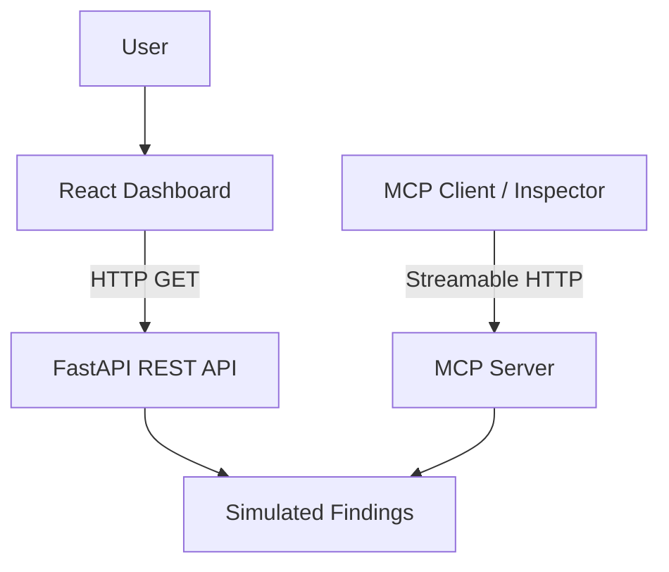

# CloudGuard AI

CloudGuard AI is a cloud security monitoring prototype that presents security findings and remediation guidance through a web dashboard and Model Context Protocol (MCP) tools.

> **Demo status:** Findings are simulated. The current prototype does not scan a live AWS account or automatically remediate cloud resources.

## Features

- React dashboard with severity summaries and security findings.
- Remediation guidance for individual findings.
- FastAPI REST API for dashboard data.
- MCP server using Streamable HTTP.
- MCP tools:
  - `get_cloud_findings` — returns simulated findings.
  - `explain_finding` — explains a finding and its recommended remediation.
- Python linting with Ruff and frontend linting with ESLint.

## Architecture



## Requirements

- Python 3.10 or newer
- Node.js and npm
- Git

## Local setup

Clone the repository and enter its directory:

```bash
git clone <YOUR_GITHUB_REPOSITORY_URL>
cd cloudguard-ai
```

Create and activate a Python virtual environment:

```bash
python3 -m venv .venv
source .venv/bin/activate
pip install -r requirements.txt
```

Install frontend dependencies:

```bash
cd frontend
npm ci
cd ..
```

## Run the application

Run each service in a separate terminal from the project root.

### 1. MCP server

```bash
source .venv/bin/activate
python backend/app/server.py
```

MCP endpoint:

`http://127.0.0.1:8000/mcp`

### 2. REST API

```bash
source .venv/bin/activate
uvicorn backend.app.api:app --reload --port 8001
```

Health check:

`http://127.0.0.1:8001/api/health`

Findings:

`http://127.0.0.1:8001/api/findings`

Interactive API documentation:

`http://127.0.0.1:8001/docs`

### 3. React dashboard

In another terminal:

```bash
cd frontend
npm run dev
```

Open the local URL printed by Vite, usually `http://localhost:5173`.

The dashboard expects the REST API at `http://127.0.0.1:8001/api`.

## MCP tools

### `get_cloud_findings`

Returns the demo environment and its simulated security findings.

### `explain_finding`

Accepts a finding ID, such as `CG-001`, and returns the corresponding issue and recommendation.

The MCP endpoint can be tested using the [MCP Inspector](https://github.com/modelcontextprotocol/inspector).

## Quality checks

Frontend:

```bash
cd frontend
npm run lint
npm run build
```

Python backend, from the project root:

```bash
source .venv/bin/activate
ruff check backend/
ruff format --check backend/
```

## Security and limitations

- Findings are simulated, not verified AWS security alerts.
- Remediation guidance is advisory and does not modify cloud resources.
- Do not commit AWS credentials, access keys, tokens, or `.env` files.
- Live AWS integration and production deployment are not included in the current prototype.

## License

A license will be added before public release.
